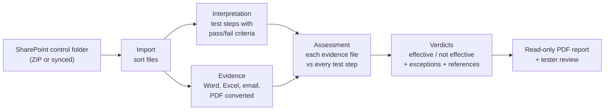

# KCT: Key Control Testing with AI

KCT prepares the test of a key control: it reads the control's documents and the
evidence collected for it, and proposes for every test step **effective** or
**not effective**, with the exceptions and the exact place in the evidence that
shows them. A tester reviews the proposal; KCT does the reading and matching.

## The problem today

Testing one key control means reading the control details and the test plan,
turning them into test steps, and then going through every piece of evidence:
ticket exports, audit-log spreadsheets with hundreds of rows, PDF reports, email
threads with approvals and attachments. Much of the time goes into reading and
cross-checking, not into judgement, and the result depends on who does it.

## How it works

1. **Import.** The control folder as the team keeps it in SharePoint (control
   details and test plan in one folder, evidence in another) is imported as a
   ZIP or a synced folder. The original is kept; files are sorted automatically.
2. **Interpretation.** The AI reads the control details and the test plan and
   writes the test steps, each with acceptance criteria (all must hold) and
   refusal criteria (any one fails the step). It adds steps for requirements in
   the control details that the plan does not cover.
3. **Evidence.** Every file is made readable for the AI without losing what
   matters: spreadsheet colors and comments, email threads with their
   attachments and screenshots. Large files are split so nothing is skimmed.
4. **Assessment.** Each evidence file is checked against every test step; then
   all findings are combined into one verdict per step.
5. **Report.** A read-only PDF: executive summary, a traceability matrix (which
   evidence supports or contradicts which step), every verdict with its reason
   and exceptions, and the fingerprint of every file assessed.

## What you get per control

| Output | Content |
|---|---|
| Test steps | One per test plan step, plus derived steps, each with pass and fail criteria |
| Verdict per step | Effective / not effective, with a reason a reviewer can check |
| Exceptions | Each failing item (e.g. ticket SD-105112), what is wrong, and where it is shown (file, page, sheet and row, email) |
| Traceability matrix | Test steps × evidence files: supports, contradicts, partly, nothing |
| Report | Read-only PDF with its SHA-256 fingerprint; every run kept |

## Guardrails

| Risk | How KCT handles it |
|---|---|
| The AI invents evidence | It must cite document and page / sheet and row / email for everything; every citation is checked against the files actually sent, and citations that do not exist are flagged in the report |
| Missing evidence passes unnoticed | No relevant evidence means **not effective**, flagged "no evidence"; a step the AI leaves out is set to not effective, flagged "fallback" |
| Large files are skimmed | PDFs over 50 pages, big spreadsheets and long email threads are split into parts; each part is assessed in full |
| A file cannot be read | It is listed with the reason (format, error); the run continues and the report shows what was not assessed |
| Results change unnoticed | Every run is stored with its model, inputs and results; reports are read-only with a fingerprint |
| Accountability | KCT proposes, a tester decides (reviewer sign-off is the next feature) |

## Licence

- One open-source package (reading Outlook `.msg` files) is GPL-licensed; to be
  confirmed with open-source compliance before production.

## What it does not do (yet)

- It does not replace the tester: verdicts are proposals to review.
- It reads what is in the files; it cannot open links or systems.
- Charts in spreadsheets and colors from conditional formatting are only seen
  when LibreOffice is available.
- Prompts have been tuned on sample data; a pilot on real controls is needed to
  measure accuracy.

## Status

| Part | Status |
|---|---|
| Import from SharePoint (ZIP or folder), automatic sorting | Done |
| Interpretation into test steps | Done |
| Evidence: Word, Excel, Outlook email, PDF, images; splitting | Done |
| Assessment, verdicts, exceptions, reference checks | Done, tested with sample data |
| Read-only PDF report with executive summary | Done |
| API and notebooks (works on the Vertex AI workbench) | Done |
| Clickable app inside Jupyter (no web server needed) | Done |
| Run on real controls with Gemini | **Next: pilot** |
| Reviewer sign-off and override | Next |

## Measured on the demo control

Fill in from the demo notebook (`DEMO.ipynb`, steps 6 and 10) after a run with Gemini:

| | |
|---|---|
| Test steps | 17 |
| Evidence files / parts | 4 / … |
| Run time | … min |
| AI cost per control | … |
| Manual effort today (estimate) | … h |

## Proposed next steps

1. **Pilot** on 5–10 real controls in the bank's Google project: compare KCT's
   verdicts with the testers' own, per test step.
2. **Reviewer sign-off**: tester accepts or overrides each verdict with a
   comment; the report shows proposal and decision.
3. **Cost**: reuse the control documents across calls (context caching).
4. **Connect to SharePoint directly**, once access is approved.

## Words used

| Word | Meaning |
|---|---|
| Case | One control being tested, named after its SharePoint folder |
| Interpretation | Turning control details and test plan into test steps |
| Test step | One check, with acceptance criteria (all must hold) and refusal criteria (any fails it) |
| Evidence part | A piece of a large evidence file, assessed on its own |
| Assessment | Checking all evidence against all test steps; ends in a verdict per step |
| Traceability matrix | Grid of test steps × evidence files showing what each file shows |
